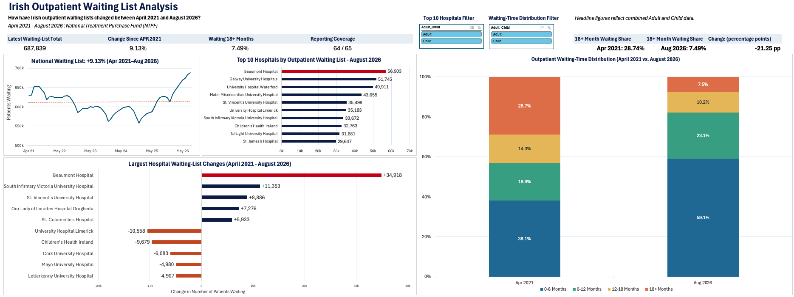

# Irish Outpatient Waiting List Analysis (2021-2026)

### Project Overview

An Excel-based analysis of Irish outpatient waiting lists using publicly available data from the National Treatment Purchase Fund (NTPF).

The project examines national waiting-list trends, hospital-level variations, regional differences and changes in waiting-time distributions between April 2021 and August 2026.

### Tools & Techniques

- Microsoft Excel
- Power Query - Data importing, cleaning and transformation
- PivotTables and PivotCharts
- XLOOKUP and COUNTIFS
- Descriptive statistics - Mean, median, standard deviation and coefficient of variation
- Interactive dashboards, KPIs and slicers

### Dataset

- **Source:** National Treatment Purchase Fund (NTPF), Ireland
- **Period:** April 2021 - August 2026
- **Records:** 4,895
- **Reporting periods:** 64
- **Data:** Hospital-level outpatient waiting-list volumes and waiting-time categories

### Key Findings

- National outpatient waiting lists increased by **9.13%**, equivalent to 57,530 additional patients.
- The proportion of patients waiting over 18 months decreased by **21.25 percentage points**.
- The ten hospitals with the largest waiting lists accounted for **58.25%** of the national total in August 2026.
- Hospital and regional comparisons highlighted substantial differences in waiting-list volumes.

### Methodology

1. Imported and combined annual datasets using Power Query.
2. Validated data for missing values, duplicates and inconsistencies.
3. Standardised hospital data and applied regional classifications using XLOOKUP.
4. Conducted national, hospital-level and regional analysis using PivotTables and statistical measures.
5. Developed an interactive Excel dashboard to communicate findings.

### Dashboard

### Project Files

- **Excel Workbook:** Data preparation, calculations, PivotTables and interactive dashboard.
- **Project Report:** Methodology, analysis, findings, limitations and references.

### Data Source

National Treatment Purchase Fund (NTPF) — [Official Website](https://www.ntpf.ie/)

### Author

James Bickerton  
UCD Professional Academy Data Analysis Diploma  
Dublin, Ireland
